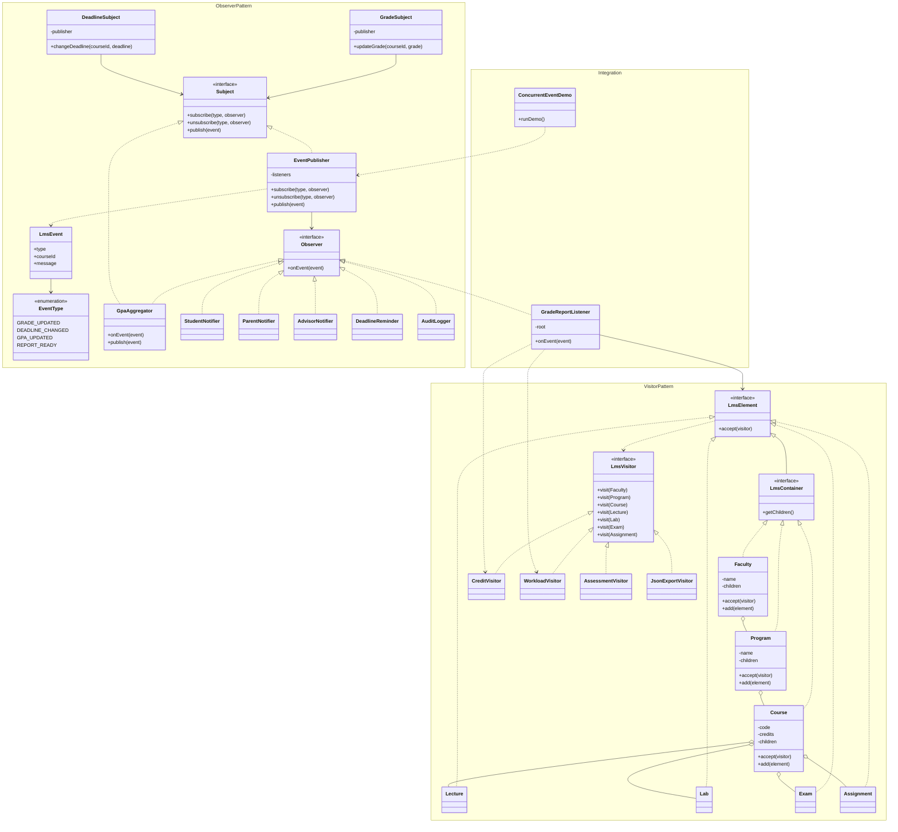

# University LMS Patterns

**Assignment 6 — Observer and Visitor Design Patterns**

## Project Overview

University LMS Patterns is a Java 17 application demonstrating the Observer and Visitor design patterns in a university learning management system.

The application manages academic notifications, grade updates, deadline changes, academic structure traversal, and report generation.

## Technologies

- Java 17
- Maven
- JUnit 5
- IntelliJ IDEA

## 1. Observer Pattern

The Observer Pattern allows subscribers to receive notifications when events occur.

**Main components:**
- `Observer` — defines the event notification interface.
- `Subject` — defines subscription and publication operations.
- `EventPublisher` — manages subscribers and distributes events.
- `GradeSubject` — publishes grade updates.
- `DeadlineSubject` — publishes deadline changes.
- `StudentNotifier` — notifies students.
- `ParentNotifier` — notifies parents.
- `AdvisorNotifier` — notifies academic advisors.
- `DeadlineReminder` — handles deadline notifications.
- `AuditLogger` — logs academic events.
- `GpaAggregator` — counts grade updates and publishes statistics events.

The system supports subscribing, unsubscribing, event filtering, and concurrent publication.

## 2. Visitor Pattern

The Visitor Pattern separates operations from the academic elements they process.

**Academic structure:**

Faculty → Program → Course → Lecture / Lab / Exam / Assignment

**Visitors:**
- `CreditVisitor` — calculates total course credits.
- `WorkloadVisitor` — calculates total lecture and lab hours.
- `AssessmentVisitor` — calculates maximum assessment scores.
- `JsonExportVisitor` — exports academic elements to JSON.

Each academic element implements `accept(LmsVisitor visitor)`.

## 3. Observer + Visitor Integration

When a grade changes, `GradeReportListener` receives the event and executes Visitors to generate an academic report.

**Flow:**

GradeSubject → EventPublisher → GradeReportListener → CreditVisitor / WorkloadVisitor

## 4. Concurrency

The application demonstrates concurrent event publishing using `ExecutorService`.

A stress test publishes 4,000 events from four producer threads and verifies event delivery using `AtomicInteger`.

## 5. Testing

The project includes 15 JUnit tests covering Observer behavior, Observer chaining, Visitor calculations, integration, and concurrency.

## 6. Running the Project

Run `Main.java` to view the Observer, Visitor, integration, and concurrency demonstrations.

Run Maven `test` to execute all JUnit tests.

## 7. Design Pattern Comparison

**Observer:** Establishes a subscription-based relationship between event publishers and listeners.

**Visitor:** Adds operations to a structure of different element types without modifying their classes for each new operation.

The two patterns work together: Observer detects changes, while Visitor processes the academic structure.

## 8. UML Class Diagram

## Author

Aida Khalila
